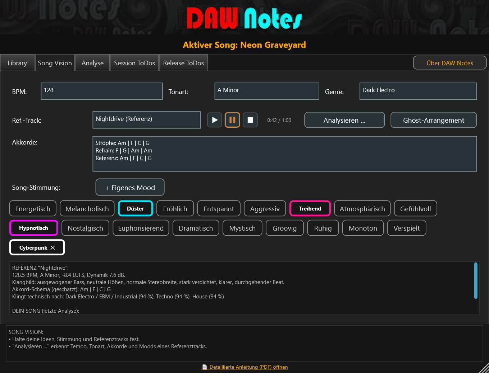

A notebook DIRECTLY in your DAW, that records ideas and tasks for the active song, from the prototype to the finished release, so that you always have an overview.

DAW Notes helps you take quick notes during the first hearing “Session All” close, if your ears still hear the song “neu” experience. You will always receive information about this, what your basic idea looked like, you should get lost.

You record tasks in the release to-dos, which you typically do AFTER the finished song: Release-Datum, Submit to distributor, Create a video for TikTok or YouTube. All of this can be set as a permanent task, so that every additional song already has these entries preset.
It's just your job, to process these points and the status “Completed” to set.

Last but not least, you can also have your song to-do sheet printed out as HTML for your home pinboard, to be able to do the last things manually, without looking into the PC.

DAW Notes does not access any data from the DAW and is located locally on your studio PC, is absolutely free and intended as a little helper for me and you.

## What's new in 2.0.0

- **Analysis tab:** press *Analyse*, play your whole song once while DAW Notes listens, and get a genre fit (loudness, dynamics, stereo width, tonal balance, tempo, rhythm) with concrete improvement tips – including the alternative genres the analysis heard. Tips can be turned into Session ToDos with one click.
- **Reference track analysis:** load a WAV/MP3/FLAC/AIFF/OGG reference in Song Vision; BPM, key, chords and moods are suggested, and a general diagnosis compares it with your own song.
- **Reference player:** Play/Pause/Stop right next to the reference field to listen while you note moods or ideas (mixed into the plugin output after the analysis tap).
- **Ghost Arrangement:** builds a MIDI file with section markers and named tracks from the reference track – a rough head start, not a replacement for training your ears; collect them as your own ghost-arrangement library.
- **Google button** at the end of every ToDo row: create a Google Task (text is copied to the clipboard) or a prefilled Google Calendar event.
- **About DAW Notes** window with the story behind the plugin, a calmer graphite header, and "New task …" placeholders in the ToDo input lines.
- **Languages:** German, English and French; the installer stores the language file matching the setup language as `settings.ini` (all texts stay editable there).
- Updated manual (`Resources/Anleitung.pdf`) with screenshots.

## Building from source

This is a [JUCE](https://juce.com/) plugin project (VST3 + Standalone), managed via `DAW Notes.jucer`.

1. Clone or download [JUCE](https://github.com/juce-framework/JUCE) somewhere on your machine.
2. Open `DAW Notes.jucer` in the Projucer and set the JUCE modules path (either the project's global path setting, or per-module in the Modules section) to point at your JUCE checkout.
3. Save the project in the Projucer to (re-)generate `JuceLibraryCode/` and the `Builds/` exporter project for your IDE.
4. Build `Builds/VisualStudio2026/DAW Notes.sln` (or the exporter for your platform) as usual.

All embedded resources live in `Resources/`. The installer script is `Installer/DAW_Notes_Installer.iss` (Inno Setup 7); `Tools/` holds the scripts that extract UI texts and generate the language files.

`Source/` contains all plugin code, including a vendored copy of [SQLite](https://sqlite.org/) (`sqlite3.c`/`.h`) - no separate database dependency needed.
